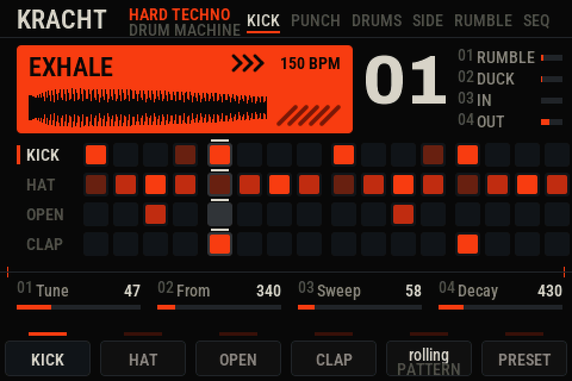
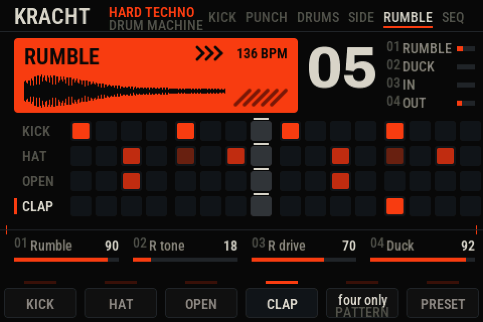

<p align="center"></p>

# KRACHT

**Hard techno drums – firmware for VIBE FM Mk1.** A synthesised kick designer, the rumble made from your own kick,
hats and clap on a 16-step sequencer, and the kick ducking whatever you plug into IN 1+2. No samples: every drum is
synthesised.

**[Listen to the demos](https://sponde.de/kracht-vibe/)** · **[Download the latest release](https://github.com/Kracht/kracht-vibe/releases/latest)** ·
**[VIBE FM player](https://play.thefirmwarehub.com/)**

Made for the [VIBE Box Challenge 2026](https://thefirmwarehub.com/lab/) on The Firmware Hub.

## Play it

- **In the browser:** open the [VIBE FM player](https://play.thefirmwarehub.com/) and drop `kracht.wasm` onto the device.
- **In the VIBE FM plugin:** drop `kracht.zip` onto the plugin window. In a DAW KRACHT follows the transport and tempo.

Both files are in the [latest release](https://github.com/Kracht/kracht-vibe/releases/latest).

<p align="center">
  
  
  
</p>

## What's inside

- **KICK** – a full kick designer: body sweep with curve and zap, amp with wall and gate, click, drive through four
  shapers at 4× oversampling (two Kaiser half-bands down), a clean sub tail on the body's phase, low cut, tone, level.
  All 30 values are DAW parameters. Seven presets: **EXHALE** (long, broken, swinging – 340 → 47 Hz, tube drive
  26 dB, long tail), KRACHT, PSY, HOUSE, RUMBLE, ZAP, INDUSTRIAL. A new hit chokes the last over 4 ms.
- **RUMBLE** – the kick through a 2.6 s dark hall, LP 320 / HP 32, a soft clipper, two low-passes at TONE, ducked by
  the kick (2 ms attack, release in beats). The hall is an FFT convolution baked per kick, so every hit plays a ready
  stereo rumble.
- **DRUMS** – closed hat (six squares and noise), open hat, clap (four bursts and a tail).
- **SEQ** – 16 steps × 4 lanes, a pattern book per lane, swing; the DAW's song position while it plays, else its own
  tempo. Mutes and pattern changes land on the next bar.
- **SIDE** – IN 1+2 mixed in and ducked by the kick: as a plugin on a bass or pad track it pumps with the kick.
  Every kick fires GATE OUT for 10 ms.
- **PERFORM** – SHIFT + a pad: 16 FX on the drums while you hold it (beat repeat, tape stop, pitch, reverse, filter
  sweeps, delay and hall throws, crush, no kick). Note repeat, overdub, quantize, fills, six scenes, a length per
  lane (polymeter), the kick tuned to a key. See [Perform](#perform).
- **MIDI** – both ways. A DAW or an MPC plays KRACHT, and KRACHT's sequencer plays a DAW track or an MPC: its notes
  go out sample-exact with the step's velocity, plus the clock and START / STOP while KRACHT leads. See [MIDI](#midi).

What the VIBE gives that the FM-1 can't: stereo audio input, GATE OUT, the 480×320 screen (live kick waveform, step
grid, meters), pads and four encoders per page, DAW transport, float DSP with oversampling and FFT convolution.

## Controls

| | |
|---|---|
| Pads | the 16 steps of the lane (tap: x → X → ghost → off) |
| SHIFT + pad | performance FX while the pad is held · tapped twice: latched, a third tap ends it |
| F1–F4 | lane KICK · HAT · OPEN · CLAP |
| SHIFT + F1–F4 | mute / unmute the lane, on the next bar |
| F5 / SHIFT + F5 | next / previous pattern from the book, on the next bar |
| F6 / OCT+ | next kick preset |
| OCT− | previous kick preset |
| Keys | C kick · D/E clap · F#/G# hat · A# open (every octave) |
| SHIFT + key | the kick tuned to that note (36–72 Hz) |
| LEFT | note repeat: tap = on / off, held = only while held |
| REC / SHIFT + REC | overdub on / off · the lane back to its book entry |
| RIGHT | fill: tap = the next half bar into a bar, held = while held |
| SHIFT + K1–K6 | scene: recall on the next bar · empty or held 1 s: store |
| K1 KICK | tune · from · sweep · decay |
| K2 PUNCH | click · drive · shape · tail |
| K3 DRUMS | hat decay · hat tone · open decay · clap decay |
| K4 SIDE | input · sidechain · glue · volume |
| K5 RUMBLE | rumble · tone · drive · duck |
| K6 SEQ | tempo · swing · repeat rate · lane level · with SHIFT: quantize · strength · lane length |
| K6 again: MIDI | map · in channel · out channel · out (off / notes / clock / both) |
| ENTER (on MIDI) | learn: the next note plays the selected lane, in and out |
| Enc A / B | volume / duck release |
| PLAY / STOP | sequencer |

`cheatsheet.html` has the same as a one-page sheet beside the device in the player. The [demos](https://sponde.de/kracht-vibe/) were all
played by hand on the firmware – the moves are in [`demos/live/HOW-TO-PLAY.md`](demos/live/HOW-TO-PLAY.md).

## Perform

**SHIFT + pad – 16 FX**, laid out as the pads (pad 1 top left). They work on the drums – kick, rumble, hats, clap –
never on IN 1+2: whatever runs through the sidechain keeps pumping under a repeat. An FX lasts as long as the pad is
held (SHIFT can go once it started); tap a pad twice quickly to latch it, once more to end it. The pad's velocity is
the amount.

| | 1 | 2 | 3 | 4 |
|---|---|---|---|---|
| REPEAT | 1 beat | 1/2 | 1/4 | 1/8 |
| PITCH | tape stop | pitch down | pitch up | reverse |
| FILTER | LP sweep | HP sweep | telephone | wash |
| THROW | delay | hall | crush | no kick |

- Rows 1–2 play from a ring of the drums, one at a time (the newest pad wins), and start and end on a 16th. A repeat
  takes what comes next and loops it; PITCH DOWN / UP loop 1/4 beat and glide up to an octave over two beats; REVERSE
  plays the last beat backwards; TAPE STOP halts in 2 beats (soft) to ½ beat (hard).
- LP / HP sweep over two beats (harder = deeper), back in 50 ms when you let go. TELEPHONE is a band-pass, WASH a
  resonant low-pass falling over a beat.
- DELAY (ping-pong, dotted 8th) and HALL are throws: the send follows the pad, the tail rings on. CRUSH: bits and
  rate. NO KICK takes the kick and its rumble out.
- While SHIFT is held the display shows the grid; what is on stays listed under the steps.

**Note repeat:** LEFT, then hold keys: their lanes repeat on the grid at the rate on SEQ · encoder 3 (1/4 … 1/32,
1/8T, 1/16T), with the key's velocity. Stopped, the grid starts with the press. **REC:** what you play on the keys or
over MIDI while the sequencer runs lands on the nearest 16th of its lane (note repeats too); a step it lands on just
ahead isn't played twice. SHIFT + REC puts the selected lane back to its book entry. **SHIFT + key:** the kick's
TUNE on that note – F = 43.7 Hz, so the kick sits in the track's key; the rumble follows.

**Quantize** (SHIFT on the SEQ page, encoders 1–2): OFF, 1/16, 1/8 or 1/4, and a STRENGTH of 50–100 %. What you
play on the keys or over USB/DIN MIDI moves to the nearest point of the grid – the 1/16 grid with the swing. Up to
30 % of a grid step late it plays at once (and REC writes it to the point just past); earlier, it waits for the next
point, or part of the way there at a lower strength. Notes from the DAW are on time already and stay as they come.
Steps edited on the pads need none: a pad is a step.

**Fill** (RIGHT): tapped, it plays the next half bar that leads into a bar – kick X . . x X . x x, hats in 16ths, the
clap rolling up, its last two steps in 32nds. Held for a quarter second, it fills from the next 16th until you let go.

**Scenes** (SHIFT + K1–K6): a scene keeps the steps (overdubs too), mutes, lane lengths, the preset and the sound –
kick, rumble, drums, swing, lane levels; not tempo, sidechain, volume or MIDI. SHIFT + K on an empty slot stores,
on a stored one recalls on the next bar (steps, mutes and lengths to the sample, the sound right after it); held for
a second it stores over it. While SHIFT is held the line under the FX grid shows the six slots. Scenes live as long
as the firmware runs.

**Polymeter** (SHIFT on the SEQ page, encoder 3): the selected lane's length, 1–16 steps. A shorter lane loops
against the others – hats in 7 against a kick in 16; the steps past the length go dark, the length stands by the
lane's name. Pattern changes and mutes still land on the bar.

## MIDI

K6 twice opens the MIDI page. Encoder 1 picks the map – one table for both directions:

| Map | In (notes that play a lane) | Out (kick · hat · open · clap) |
|---|---|---|
| KRACHT | by pitch class, any octave: C kick, D/D#/E clap, F#/G# hat, A# open | 36 · 42 · 46 · 38 |
| GM | 35/36 kick, 37–40 clap, 42/44 hat, 46 open | 36 · 42 · 46 · 39 |
| MPC | pads A01–A04 in the chromatic layout: 36 kick, 37 clap, 38 hat, 39 open | 36 · 38 · 39 · 37 |
| LEARN | one note a lane: ENTER, then play a note (RETURN cancels) | the learned notes |

- **In:** encoder 2 = channel (OMNI or 1–16). The VIBE's own keys always play by pitch class.
  Program Change 0–6 = kick preset · CC 20–23 = mute kick / hat / open / clap (value ≥ 64), CC 24–27 = the lane's
  pattern from the book (value = entry, 0 first). Both land on the next bar.
- **Out:** encoder 3 = channel (default 10), encoder 4 = OFF / NOTES / CLOCK / BOTH (default OFF). NOTES sends every
  step that plays (velocity: hit 127, accent 102, ghost 53; 30 ms gate) and what you play on the keys – never what came
  in over MIDI, so nothing loops. CLOCK sends 24 PPQ at KRACHT's tempo and START / STOP with PLAY / STOP; while a DAW or
  an external clock leads, it stays silent.
- **An MPC playing KRACHT:** map MPC, a drum track on pads A01–A04 – or LEARN for any layout. **KRACHT playing an
  MPC:** out NOTES, the MPC track's channel, its program's pads on 36–39 (MPC) or GM notes.
- The MIDI settings are parameters too (group C · MIDI), so the plugin keeps them with the project.

## Build

Needs the [VIBE FM SDK](https://github.com/Vibe-FM-SDK/vibe-fm-sdk) next to this folder (or `SDK=/path`) and
Zig 0.13.0 (on the PATH, or `ZIG=/path/to/zig`).

```sh
sh build.sh          # build/kracht.wasm + build/kracht.zip
sh build.sh check    # the same, then the SDK's vibe-check
```

The SDK takes the folder's name as the firmware's id, so the sources are staged as `build/stage/kracht`.

## License

GPL-3.0-or-later (see [`LICENSE`](LICENSE)).
