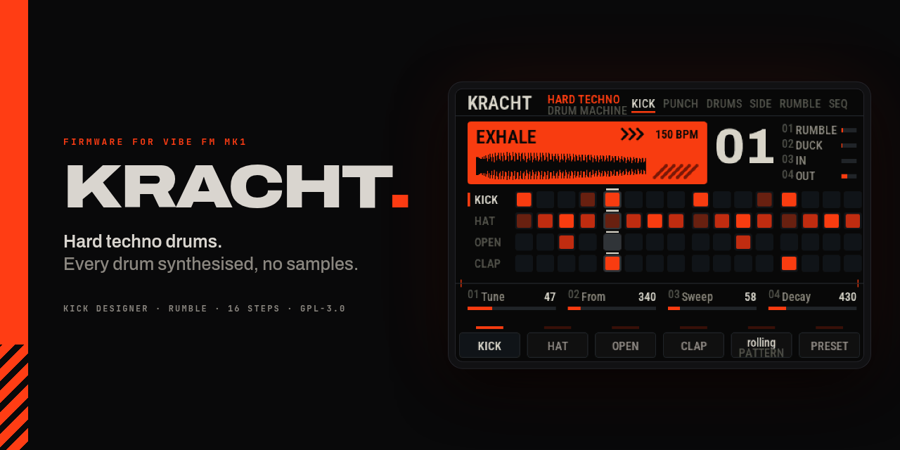
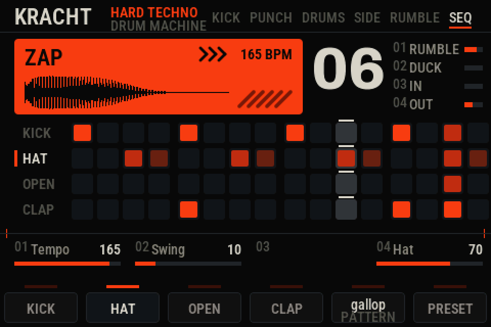

<p align="center"></p>

# KRACHT

**Hard techno drums – firmware for VIBE FM Mk1.** A synthesised kick designer, the rumble made from your own kick,
hats and clap on a 16-step sequencer, and the kick ducking whatever you plug into IN 1+2. No samples: every drum is
synthesised.

**[Listen to the demos](https://sponde.de/kracht-vibe/)** · **[Download the latest release](https://github.com/Kracht/kracht-vibe/releases/latest)** ·
**[VIBE FM player](https://play.thefirmwarehub.com/)**

Made for the [VIBE Box Challenge 2026](https://thefirmwarehub.com/lab/) on The Firmware Hub.

## Play it

- **In the browser:** open the [VIBE FM player](https://play.thefirmwarehub.com/) and drop `kracht.wasm` onto the device.
- **In the VIBE FM plugin:** drop `kracht.zip` onto the plugin window. In a DAW KRACHT follows the transport and tempo.

Both files are in the [latest release](https://github.com/Kracht/kracht-vibe/releases/latest).

<p align="center">
  
  
  
</p>

## What's inside

- **KICK** – a full kick designer: body sweep with curve and zap, amp with wall and gate, click, drive through four
  shapers at 4× oversampling (two Kaiser half-bands down), a clean sub tail on the body's phase, low cut, tone, level.
  All 30 values are DAW parameters. Seven presets: **EXHALE** (long, broken, swinging – 340 → 47 Hz, tube drive
  26 dB, long tail), KRACHT, PSY, HOUSE, RUMBLE, ZAP, INDUSTRIAL. A new hit chokes the last over 4 ms.
- **RUMBLE** – the kick through a 2.6 s dark hall, LP 320 / HP 32, a soft clipper, two low-passes at TONE, ducked by
  the kick (2 ms attack, release in beats). The hall is an FFT convolution baked per kick, so every hit plays a ready
  stereo rumble.
- **DRUMS** – closed hat (six squares and noise), open hat, clap (four bursts and a tail).
- **SEQ** – 16 steps × 4 lanes, a pattern book per lane, swing; the DAW's song position while it plays, else its own
  tempo. Mutes and pattern changes land on the next bar.
- **SIDE** – IN 1+2 mixed in and ducked by the kick: as a plugin on a bass or pad track it pumps with the kick.
  Every kick fires GATE OUT for 10 ms.

What the VIBE gives that the FM-1 can't: stereo audio input, GATE OUT, the 480×320 screen (live kick waveform, step
grid, meters), pads and four encoders per page, DAW transport, float DSP with oversampling and FFT convolution.

## Controls

| | |
|---|---|
| Pads | the 16 steps of the lane (tap: x → X → ghost → off) |
| F1–F4 | lane KICK · HAT · OPEN · CLAP |
| SHIFT + F1–F4 | mute / unmute the lane, on the next bar |
| F5 / SHIFT + F5 | next / previous pattern from the book, on the next bar |
| F6 | next kick preset |
| Keys / MIDI | C kick · D/E clap · F#/G# hat · A# open |
| K1 KICK | tune · from · sweep · decay |
| K2 PUNCH | click · drive · shape · tail |
| K3 DRUMS | hat decay · hat tone · open decay · clap decay |
| K4 SIDE | input · sidechain · glue · volume |
| K5 RUMBLE | rumble · tone · drive · duck |
| K6 SEQ | tempo · swing · – · lane level |
| Enc A / B | volume / duck release |
| PLAY / STOP | sequencer |

`cheatsheet.html` has the same as a one-page sheet beside the device in the player. The [demos](https://sponde.de/kracht-vibe/) were all
played by hand on the firmware – the moves are in [`demos/live/HOW-TO-PLAY.md`](demos/live/HOW-TO-PLAY.md).

## Build

Needs the [VIBE FM SDK](https://github.com/Vibe-FM-SDK/vibe-fm-sdk) next to this folder (or `SDK=/path`) and
Zig 0.13.0 (on the PATH, or `ZIG=/path/to/zig`).

```sh
sh build.sh          # build/kracht.wasm + build/kracht.zip
sh build.sh check    # the same, then the SDK's vibe-check
```

The SDK takes the folder's name as the firmware's id, so the sources are staged as `build/stage/kracht`.

## License

GPL-3.0-or-later (see [`LICENSE`](LICENSE)).
